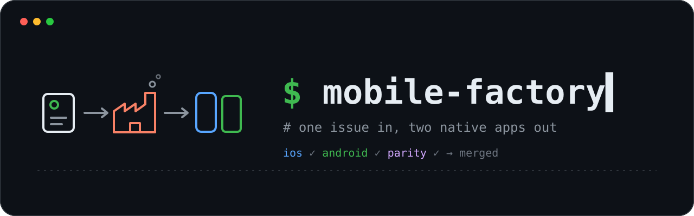
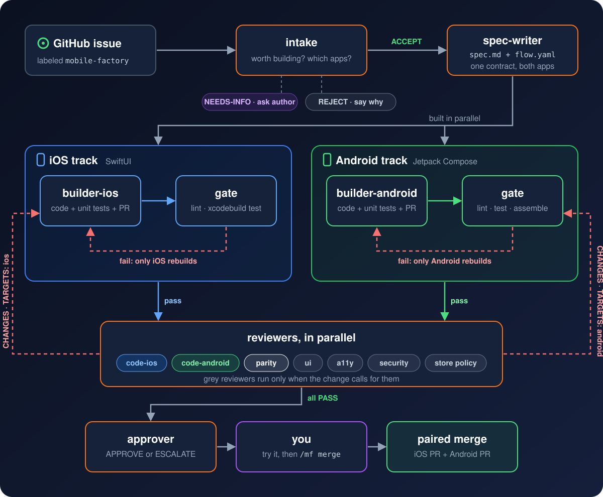

<p align="center">
  
</p>

<p align="center">
  <a href="https://github.com/br00/mobile-factory/actions/workflows/test.yml"></a>
  
  
  
  <a href="LICENSE"></a>
</p>

**mobile-factory** turns GitHub issues into merged features for products that
ship as **two native apps**: an iOS app in SwiftUI and an Android app in
Jetpack Compose, each in its own repo.

You file a feature **once**. Claude Code agents decide whether it's worth
building, write **one spec for both platforms**, build the iOS and Android
versions **in parallel**, check that the two behave the same, review them, and
hand you both PRs to merge together.

## The factory floor

<p align="center">
  
</p>

Every arrow is a decision made by one tested CLI, `bin/mf`, never by a prompt.
Agents do the judgment calls; scripts decide the facts.

## What makes it mobile

|  | |
|---|---|
| 📐 **One contract** | The spec defines behaviour, an **accessibility-id table**, string keys, and a Maestro `flow.yaml` that selects elements only by those ids. Both apps run the same flow, so parity is tested rather than taken on trust. |
| 🛤️ **A track per platform** | iOS and Android build, run their checks, fail and retry independently. A broken Android build never blocks or re-runs iOS. |
| 🎯 **Targeted rework** | Every review names the side that's wrong (`TARGETS: android`), and only that builder runs again. |
| ⚖️ **A parity reviewer** | It reads both diffs side by side, looking for missing states, different rules or copy, missing ids, and analytics drift. It doesn't flag platform idioms. |
| 🏪 **Store-aware** | Reviewers check HIG and Material 3, VoiceOver/TalkBack and Dynamic Type, Keychain/Keystore, deep links, privacy manifests and Data safety. The approver escalates new permissions, SDKs and OS bumps to you. |
| 🔒 **Locked-down agents** | Each agent can write only its own file, enforced by a hook. Checks run from the factory repo, never from the branch. Signing, entitlements, keystores and CI are protected paths. |
| 🤝 **A paired merge** | Both branches are synced and re-checked, then merged in order. If the second merge fails, the job tells you which app is ahead, and a retry merges only what's left. |
| 💾 **Resumable** | All state lives in `jobs/<id>/`. Kill the session and `/mf run` picks every job up where it was. |

## A run looks like this

```text
> /mf run
001-add-dark-mode-toggle: intake ACCEPT -> spec
001-add-dark-mode-toggle: spec written -> build round 1 (ios, android)
001-add-dark-mode-toggle: ios built 4f2a9c1 -> gate
001-add-dark-mode-toggle: android built 9be01d7 -> gate
ios gate-ios-1: PASS (checks exit 0 in 212s) -> 001-add-dark-mode-toggle build
android gate-android-1: FAIL (checks exit 1 in 148s) -> 001-add-dark-mode-toggle build
001-add-dark-mode-toggle: android built c81e3a0 -> gate
android gate-android-2: PASS (checks exit 0 in 139s) -> 001-add-dark-mode-toggle review
001-add-dark-mode-toggle: reviews code-ios:PASS code-android:PASS parity:CHANGES ui:PASS a11y:PASS -> build
   ... round 2: only android rebuilds ...
001-add-dark-mode-toggle: approver APPROVE -> needs-human
   Waiting on you: try both builds, then /mf merge 12

> /mf merge 12
001-add-dark-mode-toggle: merged ios #41, android #57
```

## Quick start

**You need** macOS with Xcode, a JDK and the Android SDK,
[Claude Code](https://claude.com/claude-code), `python3` 3.9+ (the one that
ships with macOS is fine), `git`, and the [GitHub CLI](https://cli.github.com/)
signed in with push access to both app repos. Optional:
[`maestro`](https://maestro.mobile.dev/) and `swiftlint`.

```bash
# 1. Make your own factory: click "Use this template" on GitHub, or
git clone https://github.com/br00/mobile-factory.git my-product-factory
cd my-product-factory

# 2. Put your app clones next to it
git clone git@github.com:acme/app-ios.git ../app-ios
git clone git@github.com:acme/app-android.git ../app-android

# 3. Point the factory at them (this also creates the issue labels)
bin/mf init --issues acme/my-product-factory \
            --ios acme/app-ios=../app-ios \
            --android acme/app-android=../app-android

# 4. Tell it how to build each app: scheme, simulator, Gradle tasks
$EDITOR mf.config.json

# 5. Check everything, including that both apps pass their checks on main
bin/mf doctor --checks
```

Then open Claude Code in the factory folder, label an issue
`mobile-factory`, and:

```
/mf run            work every labeled issue (and resume anything unfinished)
/mf run 12         work issue #12 now
/mf merge 12       you tried it and you're happy: merge both PRs
/mf <anything>     ask, give feedback, answer a question, drop a job, file a feature
```

```
/mf what's waiting on me?
/mf feedback on 12: the toggle should follow the system setting by default
/mf 12, android only: use a Switch, not a Checkbox
/mf reject 14, we're not doing tablets this quarter
/mf add a "copy link" button to the share sheet
```

`--issues` can be any repo you can label issues in: the factory itself,
either app, or a separate product repo. Building only one app? Pass only
`--ios` or only `--android`.

## The crew

| agent | model | job |
|---|---|---|
| 🚪 `intake` | opus | ACCEPT, NEEDS-INFO or REJECT; picks platforms; rates risk and surfaces. No shell. |
| 📐 `spec-writer` | opus | `spec.md` (behaviour, acceptance criteria, ids, strings, per-platform notes) and `flow.yaml` |
| 🛠️ `builder-ios` | opus | SwiftUI code, unit tests, the draft PR. Resumed across rounds. |
| 🛠️ `builder-android` | opus | Compose code, unit tests, the draft PR. Resumed across rounds. |
| 🔍 `reviewer-code-ios` / `-android` | haiku → sonnet by risk | correctness, concurrency, state, lifecycle, tests |
| ⚖️ `reviewer-parity` | sonnet | the same product on both sides |
| 🎨 `reviewer-ui` | haiku | design system, HIG / Material 3, dark mode, screen sizes |
| ♿ `reviewer-a11y` | sonnet | VoiceOver, TalkBack, Dynamic Type, contrast, touch targets |
| 🛡️ `reviewer-security` | opus | Keychain/Keystore, ATS, deep links, exported components, WebViews |
| 🏪 `reviewer-store` | sonnet | permissions, privacy manifest, Data safety, payments, SDKs |
| ✅ `approver` | opus | APPROVE or ESCALATE, with "try it" steps for you |

The code reviewers always run. The others are routed in `mf.config.json` by
the risk and surfaces intake picked, so a small copy fix costs one or two
Haiku reviews, not seven.

## Configuration

`bin/mf init` writes `mf.config.json` from
[`mf.config.example.json`](mf.config.example.json).

| key | what it does |
|---|---|
| `issues_repo` | `owner/repo` whose labeled issues are the queue |
| `concurrency` | jobs running at once. Keep it at **1** until the device pool lands, because two iOS jobs share one simulator |
| `max_rounds` | build, gate and review rounds per job before it asks you |
| `max_gate_attempts` | check failures allowed per platform per round |
| `auto_merge` | `false` (default): approved jobs wait for `/mf merge`. `true`: APPROVE merges straight away |
| `merge_method`, `merge_order` | how and in which order the two PRs merge |
| `labels` | the queue label and the two "parked" labels |
| `targets.<t>.repo / path / base` | app repo, local clone, base branch |
| `targets.<t>.checks`, `.env` | the checks script the gate runs, and its variables (scheme, simulator, Gradle tasks) |
| `targets.<t>.protected_paths` | globs a branch may not modify or delete |
| `routing` | reviewer models by risk, plus the extra reviewers per surface |

The checks scripts, [`targets/ios/fast.sh`](targets/ios/fast.sh) and
[`targets/android/fast.sh`](targets/android/fast.sh), are yours to edit.
Keep them non-interactive, and never let them rewrite files.

> **iOS tip:** with classic Xcode groups, every new file means an edit to
> `project.pbxproj`, and that is where agents struggle most. Switching to
> Xcode 16 synchronized folders, XcodeGen or Tuist makes the iOS builder far
> more reliable. `bin/mf doctor` tells you which one you have.

## Safety

- It opens and merges **real PRs** on your Claude plan. Start with
  `concurrency: 1` and `auto_merge: false`, and read every PR until you trust
  it.
- Only labeled issues run, and labels need triage access. Issue text reaches
  agents only as quoted data, never as a prompt.
- Agents push only `factory/<job>` branches. Only `bin/mf merge` merges. The
  factory never uploads to App Store Connect or the Play Console.

## Roadmap

- [x] State machine with per-platform tracks, fast gates, routed reviewers, paired merge
- [ ] **Device pool**: leased simulators and emulators, so `concurrency` can go above 1
- [ ] **Full gate**: run `flow.yaml` with Maestro on both platforms, with screenshots per round
- [ ] **Preview builds**: Firebase App Distribution / TestFlight / Play internal testing links on the issue
- [ ] **Dashboard**: one card per job, both tracks, a screenshot grid
- [ ] Cost per job
- [ ] A Kotlin Multiplatform `shared` target that builds before both apps

[DESIGN.md](DESIGN.md) explains how it all works and why.

## Contributing

```bash
python3 -m unittest discover -s tests
```

[`tests/test_e2e.py`](tests/test_e2e.py) drives whole jobs through `bin/mf`
against throwaway local git repos and a fake `gh`, so it needs no network
and no GitHub account. [CLAUDE.md](CLAUDE.md) has the conventions. Issues
and PRs are welcome.

## Credits

The idea of an issue-driven software factory, with scripts for the facts and
agents for the judgment calls, was inspired by ZazenCodes' "software factory"
series. mobile-factory is an independent implementation for native mobile
apps and shares no code with it.

## License

[MIT](LICENSE) © Alessandro Borelli
